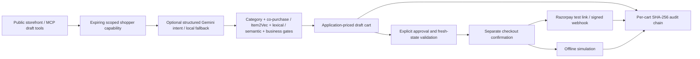
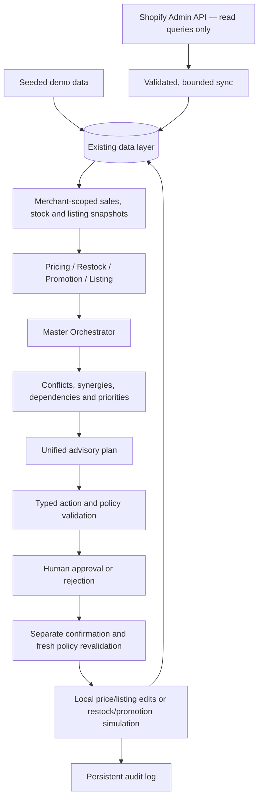

# CartPilot Architecture — Verified MVP

## Platform upgrade design boundary

[UPGRADE_ARCHITECTURE.md](UPGRADE_ARCHITECTURE.md) describes the proposed architecture;
[REPOSITORY_AUDIT.md](REPOSITORY_AUDIT.md) records current gaps and security advisories.
No reservations, checkout orders, forecasting pipeline, durable graph runtime or image
retrieval have been added by the audit/planning publication. Existing architecture below
remains current; [UPGRADE_PROGRESS.md](UPGRADE_PROGRESS.md) separates planned/delivered work.

## Commerce workflow continuation (Phase 18)

`18_commerce_workflows` adds four independent tables after `17_commerce`:
ShoppingConversation (bounded messages/context per scoped shopper capability),
CommerceOperation (unique cart/request-key claims and financial/recovery state),
CommerceRules (merchant-controlled compatibility, growth rules and scheduler state),
ShopperHandoff (five-minute, single-use, source-owner-bound browser transfer).
Existing catalog, accounts, carts and sales are retained.

Conversation can suggest products and construct/revise typed drafts; financial intents
only expose deterministic eligibility. Cart edits, substitutions and offers create
fresh drafts requiring approval. Recovery-offer prices use current product cost,
stock/reorder protection, discount caps and a ceiling-rounded retained-margin floor;
they do not modify catalog prices. Discount metadata is bound into the cart hash chain
and revalidated before approval/checkout. Concurrent offer acceptance serializes under
the original cart lock and creates one draft per idempotency key.

Resolution checks hash integrity and cart ownership, serializes request-key claims
under a cart row lock, and accounts only confirmed successful refunds against the
captured balance. Claims are committed before remote mutations. Unknown results remain
pending; reconciliation reads provider state rather than blindly repeating requests.
Test link/payment/reference/amount/currency and refund balances are checked. Simulated
refunds are explicitly marked. Return review/approval/receipt is separate from refund
authorization and never changes physical stock or represents real fulfillment.

Shopper capabilities are stored in browser sessionStorage for reload restoration,
with concurrent creation deduplicated. One-hour expiry still applies. MCP financial
tools return single-use browser handoffs; model tool arguments cannot authorize a
payment/refund. Redeeming a handoff invalidates other grants bound to the old owner;
approval is reset for an approved cart. Merchant resolution requires account scope.

Explicit merchant rules select at most two in-stock ranking features per cycle.
Scheduled claims use the database and run only in an opt-in persistent worker;
serverless web handlers do not spawn a background loop. Weather is an optional fixed
Open-Meteo read; seasonal tags are heuristics, campaign/festival dates are merchant
inputs. Ranking comparisons and observed co-purchase lift are descriptive, not proof
of conversion uplift or incremental revenue. Optional OpenAI/Gemini failover emits
validated intent/category suggestions. Local MiniLM is separately installable and is
not bundled into the lightweight hosted API. See [capability guide](docs/COMMERCE_PARITY.md).

## Buyer commerce extension (Phase 17)

The merchant architecture below remains intact. `/shop/{merchant_id}` is an opt-in
public storefront; `/buyer` previews the signed-in merchant's catalog and `/growth`
manages commerce policies, catalog CSV onboarding and recommendation models.

Shopper tokens are random, stored hashed, valid for one hour, and grant access only
to their own carts in one store. Public sessions require merchant publication;
private previews require existing account identity. Public projections omit costs,
account emails and analytics. Commerce responses are non-cacheable. Database-backed
peer and shopper request budgets constrain session creation/search/cart/model work.

The new CommercePolicy, ShopperSession, ShoppingCart, CommerceEvent and CommerceModel
tables are added by `17_commerce`, after `16_reliability`. No existing sales/catalog
data is replaced. Each cart lasts 15 minutes, uses integer INR paise, caps quantities
and lines, and rejects supplied prices/duplicate lines. Prices, product status,
category restrictions, stock, caps and audit integrity are rechecked before approval
and checkout. PostgreSQL row locks and atomic state claims serialize duplicate checkout.

Optional AI receives untrusted search text and returns a Pydantic-validated intent;
it receives no mutation tools or database connection. Provider failure uses local
search. Merchant-triggered semantic indexing fingerprints catalog text; changed
documents are excluded until reindexed. Item2Vec training is bounded, experimental,
merchant-scoped and explicit; no background retraining or calibrated lift is claimed.

Checkout is offline simulation or explicitly configured Razorpay **test** mode.
Live keys are rejected. An external request claim is committed before the call;
ambiguous failures remain pending and need manual provider reconciliation, avoiding
blind repeat calls. Signed paid-link webhooks check provider ID, reference, currency,
amount and state. Simulations/test payments never create sales, reserve/decrement
stock or fulfill orders. Hash chains detect inconsistent edits but are not signed,
externally anchored or immutable against a privileged database writer.

MCP is a minimal newline JSON-RPC stdio adapter calling the same HTTP contracts.
The Phase 17 adapter began with search/product/draft-cart/status/audit tools.
Phase 18 expands it with scoped owner growth tools and browser financial handoffs;
model tools never authorize checkout, refunds or privileged merchant changes. See [commerce guide](docs/BUYER_COMMERCE.md).

## Original merchant decision-support architecture

## Implemented stack and boundaries

React 18 + TypeScript + Vite frontend provides Dashboard, Products, Inventory,
AI Manager, Recommendations, Agent Activity, Approvals, Action History and Integrations.
FastAPI exposes typed APIs; SQLAlchemy async services read/write the existing models.
PostgreSQL is the deployment target, SQLite is used for isolated tests/offline demos.
Redis is optional infrastructure diagnostics; recommendations/execution do not depend
on Redis availability. Health explicitly reports configured disconnected components as degraded. An empty
REDIS_URL disables Redis diagnostics; database-only health can remain ok.

All four specialists and the orchestrator use deterministic Python rules and Decimal
money calculations. These merchant modules do not use an LLM, LangGraph runtime or automatic learning.
Phase 17 buyer capabilities are described separately above. Confidence/quality/priority scores are documented heuristics, not
calibrated predictions. Analysis cannot execute or implicitly flush pending changes.

Product, Inventory, Order, OrderItem and PriceHistory store analysis data. Existing
Recommendation, Action, Approval and AuditLog implement guarded local execution.
AgentRun now stores merchant-scoped orchestration summaries exposed by /agent-runs
and the Agent Activity page. Standalone specialist cards retain browser-session history;
legacy AgentRun rows without a merchant are excluded from the historical feed. ShopifyConnection/ExternalProductMapping/
ExternalOrderMapping hold source identity, location snapshots and last-sync metadata;
no credentials or unnecessary customer payloads are retained.

## Security and consistency

The MVP validates merchant-product/recommendation/action ownership. Frontend analysis
calls always send merchant scope. Legacy single-product APIs permit omitted scope
for compatibility in anonymous development/test demos. Phase 15 binds authenticated
requests to the session merchant, including these legacy routes, and requires accounts
for production business APIs. Database-backed authentication rate limits are shared across instances. General
public readiness still requires provider ingress controls and broader security/load review. Action writes and Shopify routes are restricted
to development/test. Sessions use opaque revocable tokens; see the continuation below.

Approval and execution are separate. Atomic claims, PostgreSQL row locks, source-value
comparisons, immutable payload verification, current-state policy validation, savepoints,
unique workflow identity and audit events protect execution. SQLite enables foreign
keys in app/tests, but does not prove PostgreSQL locking behavior. All policies require
human approval. Simulated replenishment does not satisfy actual stock arrival.

Shopify is the external source; the local DB is an analysis/cache layer. The fixed
GraphQL query registry cannot dispatch arbitrary mutations or follow redirects.
Credentials come only from backend environment settings. Agents never call Shopify.
Sync is bounded, uses idempotent mappings and independent commits, and reports partial
failures. It can run manually or in the optional persistent scheduled worker. Missing
cost/stock blocks dependent unsafe recommendations.
Local actions are explicitly not synchronized to Shopify.

No SQL bind values, raw infrastructure exceptions or upstream Shopify payloads are
logged. API failures return sanitized 503/500 responses. CORS defaults to explicit
local frontend origins; wildcard production origins are rejected. Secrets, local DB
files and generated dependencies/builds are excluded from Git and Docker contexts.

Timestamps are UTC: PostgreSQL retains timezone-aware columns, while SQLite returns
naive UTC values. Public product/inventory/history/action timestamp schemas normalize
those SQLite values to UTC. Browser presentation uses the browser's local timezone.
Money uses Decimal and two-decimal Numeric(10,2); frontend formatting is presentation
only, with no FX conversion. Shopify approximate discounted units round explicitly.

## Limits and performance

Catalog pages max out at 100 products; saved recommendations at 200. Intelligent
store analysis uses at most 100 active products and exposes truncation, failures and
omitted queue items. MAX_ACTIONS_PER_PLAN bounds priority candidates; unsafe work
stays visibly blocked. Shared lookbacks reuse snapshots. Catalog reuses preloaded
products/inventory/history and batches sales/history aggregates in two queries per page.
Single-product analysis combines recent/lifetime sales in one query; store orchestration
still gathers specialist context per product.

See [Phase 12 matrix and evidence](phases/PHASE_12.md) for regression, failure injection,
clean bootstrap, browser walkthrough, performance and unverified deployment limits.

## Deployment boundary (Phase 13)

Browser → HTTPS static frontend → HTTPS Python/FastAPI service → managed PostgreSQL.
Optional Redis provides diagnostics; backend-only Shopify read access is available
only in a protected private demo under the existing development/test gate. Production
mode keeps guarded writes and Shopify routes blocked. Phase 15 adds required account
authentication for production business APIs.
Backend validates environment, database URL, port and log level centrally; serving,
release migrations and explicit demo seeding are separate operations. Frontend API
URL is a public build-time setting; static host routing falls back to index.html.
See [DEPLOYMENT.md](DEPLOYMENT.md) for configuration and actual verification limits.

## Sense → Decide → Act → Learn (final academic description)

**Sense:** demo/Shopify read-only data, scoped product/order/inventory/history reads and
shared sales/coverage/listing signals. **Decide:** four deterministic specialists and
Master Orchestrator relationship/priority rules. **Act:** policies, human review, separate
confirmation and fresh guarded local mutation or simulated operations. **Learn:** audit
and outcomes are recorded for human review; there is no autonomous retraining, adaptive
model update or reinforcement learning. The feedback arrow represents updated local
data for subsequent analysis, not a trained learning loop.

[Algorithms](docs/ALGORITHMS.md), [API/entities/security](docs/API_DATABASE_SECURITY.md),
[final status](FINAL_STATUS.md) and [test evidence](TEST_SUMMARY.md) are the submission
references. Confidence scores are heuristic; no measured business uplift is claimed.

## User-authorized account/store continuation

The new account boundary uses scrypt password hashes and hashed, revocable opaque
sessions. Production business routers require authentication and compare caller scope
to the session's merchant; merchants are filtered to the account's store. New management
APIs always require an account. Product archive preserves history, manual prices create
PriceHistory, sales reference import is bounded/idempotent and creates scoped orders.
These additions do not enable external agent execution or production guarded action writes.
See docs/ACCOUNT_STORE_MANAGEMENT.md for remaining identity and notification limitations.
