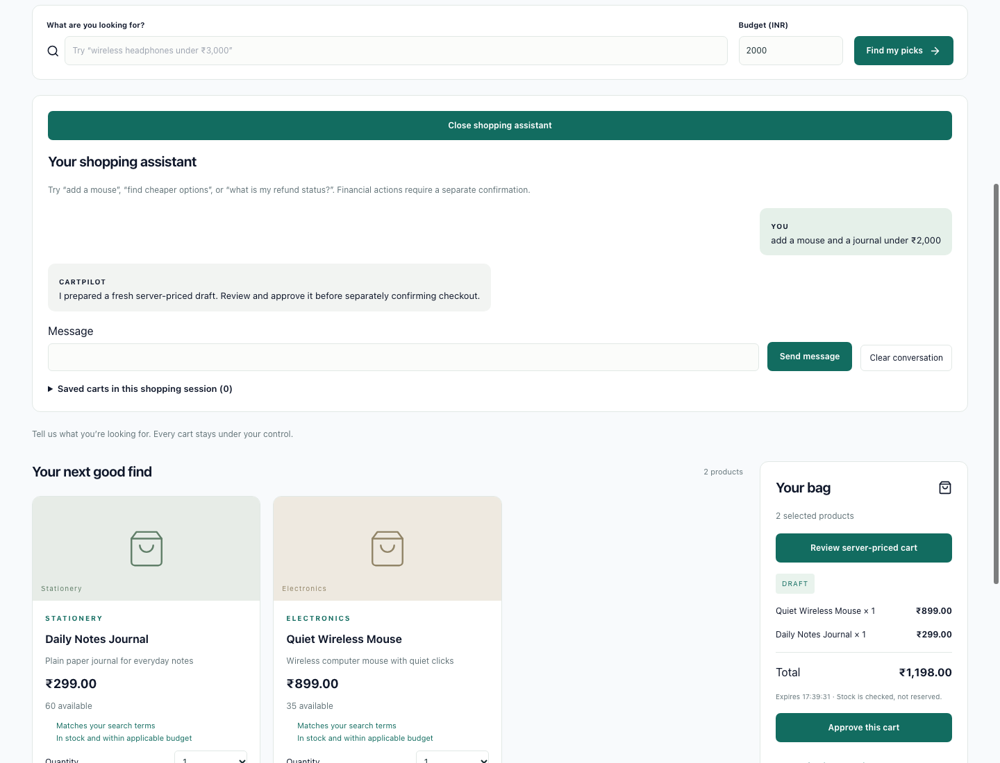
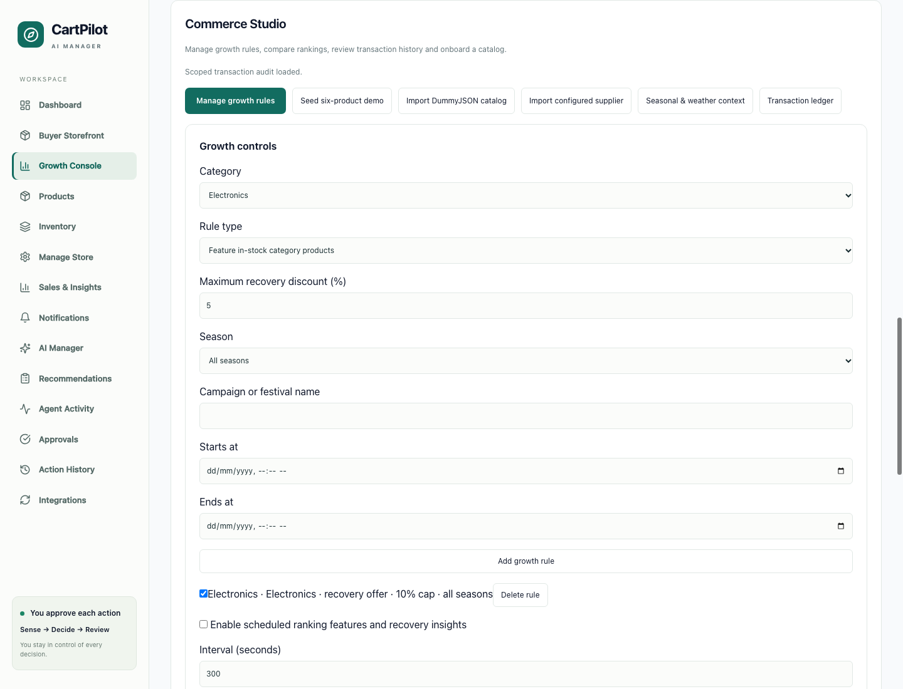
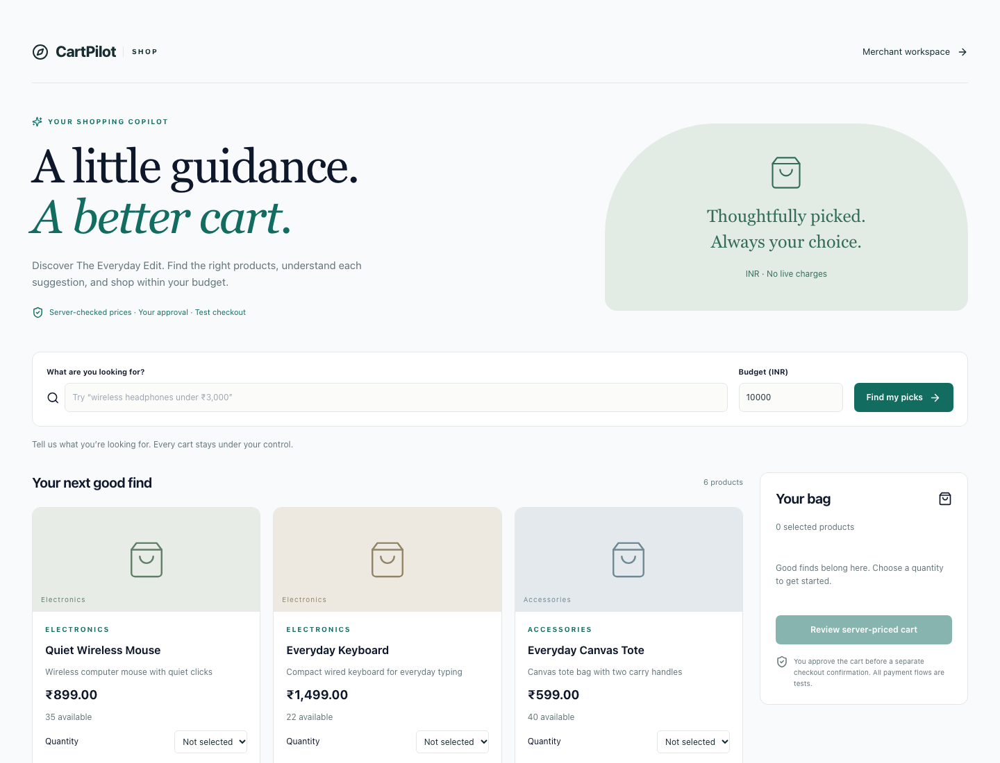
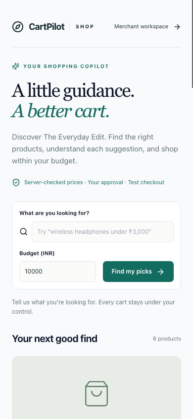
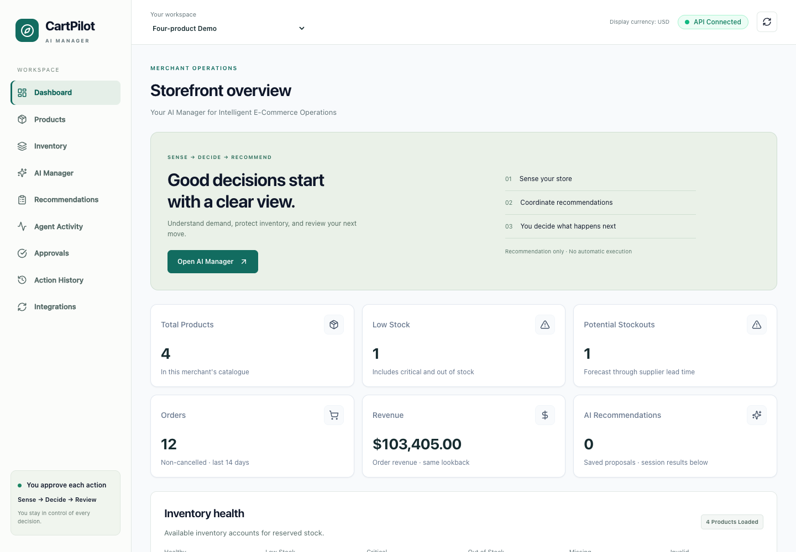
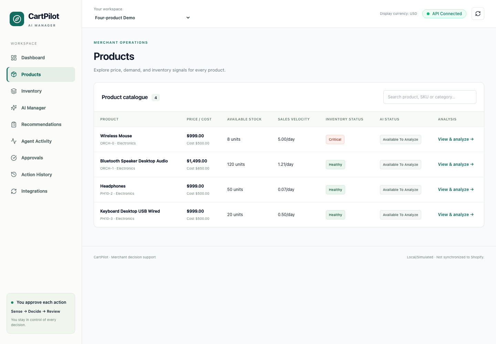
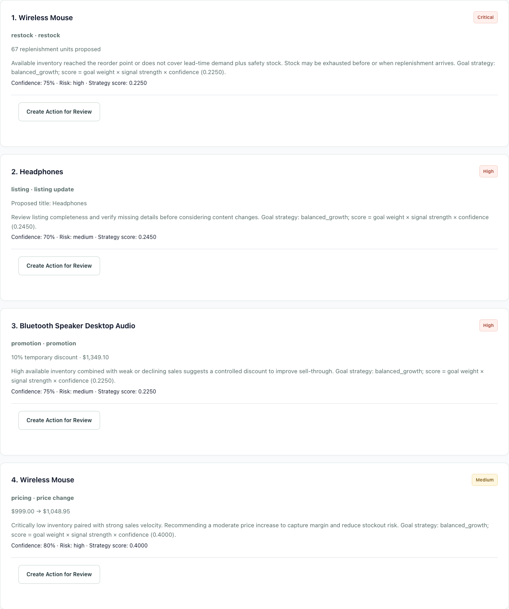
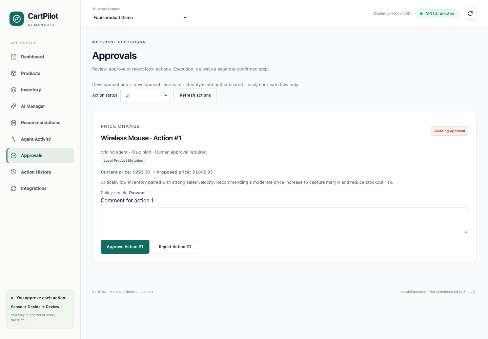
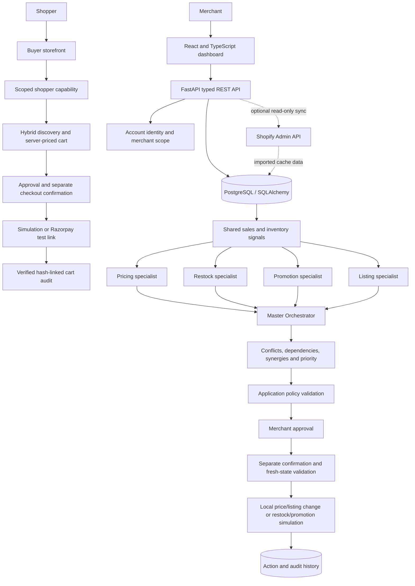

<div align="center">

# CartPilot

### Explainable shopping. Merchant-controlled decisions.

CartPilot combines a buyer shopping experience with a merchant decision-support
workspace. Shoppers discover products, build budget-checked carts and explicitly
approve test checkout. Merchants control public storefronts, recommendation boosts
and category policies, while four deterministic specialists coordinate pricing,
restocking, promotions and listing recommendations.

[](https://react.dev/)
[](https://www.typescriptlang.org/)
[](https://www.python.org/)
[](https://fastapi.tiangolo.com/)
[](https://www.postgresql.org/)
[](https://tailwindcss.com/)
[](https://www.docker.com/)
[](.github/workflows/ci.yml)

[Live demo](https://cart-pilot-seven.vercel.app/) ·
[Source code](https://github.com/Priyanshuraj0909/CartPilot) ·
[Documentation](#documentation) ·
[Report an issue](https://github.com/Priyanshuraj0909/CartPilot/issues)

</div>

> **Current boundary:** Merchant specialists remain deterministic. Buyer search optionally
> uses Gemini structured intent, explicit experimental Item2Vec training and indexed
> semantic embeddings, with local fallbacks. Checkout is offline simulation or Razorpay
> **test mode only**. Recommendations never implicitly approve actions, charge money,
> place supplier orders or change Shopify.

## Platform upgrade · audit and planning

The [repository audit](REPOSITORY_AUDIT.md) checks current implementations against code,
tests and dependency scans. The production-oriented upgrade is planned in dependency
order; **phases 19–27 are not implemented yet**. Existing Phase 18 features remain intact.

[Master plan](UPGRADE_MASTER_PLAN.md) · [Target architecture](UPGRADE_ARCHITECTURE.md) ·
[Roadmap and Apple Silicon setup](UPGRADE_ROADMAP.md) ·
[Test strategy](UPGRADE_TEST_STRATEGY.md) · [Progress](UPGRADE_PROGRESS.md)

Fresh audit verification: 738 backend tests, 174 frontend tests, production build and
five PostgreSQL concurrency checks pass. Security scans identify 13 npm build/test
package entries and two Python advisories; production-only npm reports zero findings.
These remain open remediation work. Deployment success is not a production-readiness claim.

## Complete commerce workflows · Phase 18

- **Conversational shopping:** multi-product drafts, saved chat/carts, edits, substitutes
  and upsells, with explicit review before checkout.
- **Recovery and resolution:** margin-safe recovery offers, single-use browser handoff,
  provider reconciliation, cancellation, full/partial test refunds and return review.
- **Commerce Studio:** category compatibility suggestions/overrides, growth rules,
  ranking comparisons, observed co-purchase lift, audit and selection metrics.
- **Onboarding and providers:** CSV/API/demo catalogs, OpenAI/Gemini failover,
  64-dimensional Item2Vec and optional local MiniLM semantic indexing.
- **Scheduled controls:** opt-in persistent ranking/insight worker, seasonal/campaign
  windows and optional weather context. Financial actions remain human-confirmed.

[Capability parity, setup and precise boundaries](docs/COMMERCE_PARITY.md).

<p align="center">
  
  
</p>

## Buyer commerce foundation · Phase 17

- **Buyer Storefront:** natural-language discovery, INR budgets, transparent suggestions
  and server-priced carts with separate approval and checkout confirmation.
- **Hybrid ranking:** category relevance, completed-order co-purchases/optional trained
  Item2Vec, lexical/optional semantic similarity, and stock/budget/merchant controls.
- **Growth Console:** opt-in public catalog, spend caps, blocked categories, featured
  products, CSV onboarding, model controls and clearly labeled test activity.
- **Mandate audit:** per-cart SHA-256 chain and verification; Razorpay test webhooks
  verify signatures, amounts and references. Hash linking is not external immutability.
- **MCP adapter:** product search, draft carts, status and audit for compatible clients;
  current Phase 18 adds scoped owner growth tools and browser financial handoff;
  models cannot authorize checkout or privileged merchant changes.

<p align="center">
  
  
</p>

These are real Chrome captures using synthetic local data. See the
[complete buyer guide](docs/BUYER_COMMERCE.md) for setup, provider keys, algorithms,
MCP configuration and precise limitations. This extension is an original implementation
within CartPilot, not a copy of another repository.

## See the merchant workspace

The repository includes real browser captures of the seeded Four-product Demo. They use
synthetic data; the Shopify screen uses a mocked offline integration, not a live store.

<p align="center">
  
  
</p>
<p align="center">
  
  
</p>

[Browse all 21 screenshots and reproduction notes](docs/screenshots/README.md).

## Why CartPilot?

Commerce decisions affect one another. A promotion can increase demand for an item that
is already close to selling out; a price adjustment can work against a listing change.
CartPilot evaluates sales and inventory through specialist rules, then surfaces a
single explainable plan so a merchant can review those trade-offs together.

The project focuses on **coordination and guarded action**: each recommendation has a
reason and risk context; the orchestrator exposes blocked work, conflicts, synergies,
dependencies and partial failures. Review, approval and execution are distinct steps.

## Capabilities

| Area | Current behavior |
| --- | --- |
| Buyer commerce | Private account preview and opt-in public storefront, scoped expiring shopper sessions, guarded carts and test checkout |
| Discovery models | Optional structured Gemini intent, bounded explicit Item2Vec training and fingerprinted Gemini semantic indexing |
| Growth controls | Merchant spend/category/featured-product policies, CSV catalog import, idle-cart insights and separate test metrics |
| Shopping MCP | Expanded discovery/draft/status/merchant tools and browser checkout/cancellation handoff; no autonomous financial authorization |
| Merchant workspace | Sign up, sign in, recover login email using store name and password, and access account-scoped store data |
| Catalog and inventory | Create, edit and archive local products; view physical, reserved and available stock and price history |
| Sales and insights | Import bounded, idempotent CSV sales; view recorded revenue, product rankings and in-app low-stock alerts |
| Pricing specialist | Recommend bounded price reviews using price, cost, sales history and stock signals |
| Restock specialist | Estimate coverage, stockout exposure and capped replenishment quantities |
| Promotion specialist | Identify slow or excess stock opportunities with stockout and retained-margin checks |
| Listing specialist | Flag content/completeness issues and suggest grounded copy without inventing product facts |
| Master Orchestrator | Analyze merchant goals, coordinate relevant specialists, prioritize a bounded queue and explain cross-agent relationships |
| Review and audit | Approve or reject proposals; separately confirm eligible execution; inspect recorded action history |
| Saved AI Manager activity | Review merchant-scoped plan summaries across sessions, including partial results and failed-analysis counts |
| Shopify (optional) | Development/test read-only sync of products, inventory and recent orders; optional persistent cache-refresh worker |

Stock notifications are in-app only. Sales import records sales and does not decrement
physical stock. Shopify credentials stay backend-side; imported data does not write back
to Shopify.

## Architecture



The four specialists use shared store context but own separate rules and typed outputs.
The orchestrator selects work for a merchant goal, applies inventory safety overrides,
exposes incomplete specialist results and creates a deterministic, prioritized advisory
queue. Exact thresholds and rounding are in [docs/ALGORITHMS.md](docs/ALGORITHMS.md).

## How a guarded action flows

1. The merchant signs in and works within their account's store scope.
2. They manage catalog data or import sales; optional Shopify sync reads external data into the local cache.
3. Specialists generate explainable recommendations from current data.
4. The orchestrator combines recommendations and reports conflicts and blocked items.
5. The merchant reviews and approves or rejects eligible proposals.
6. Execution requires a separate confirmation and rechecks current state and policy.
7. Local price/listing changes or restock/promotion simulations are recorded in action history.

Specialists never execute actions. Local price and listing actions can update CartPilot's
database after the guarded workflow. Restock and promotion execution only records a
simulation: it does not create a supplier order, receive inventory or launch a campaign.
No execution changes Shopify.

## Technology

| Layer | Tools |
| --- | --- |
| Frontend | React 18, TypeScript, Vite, Tailwind CSS |
| API | Python 3.12+, FastAPI, Pydantic, Uvicorn |
| Data | PostgreSQL, async SQLAlchemy, Alembic; SQLite for isolated tests and demos |
| Shopify | Read-only Admin GraphQL integration; optional persistent sync worker |
| Buyer AI | Optional Gemini REST structured intent and embeddings via existing httpx; local fallback |
| Co-purchase model | Bounded 64-dimensional Item2Vec skip-gram training using the Python standard library |
| Checkout | Offline simulation or optional Razorpay test payment links and signed webhooks |
| Tests | pytest, pytest-asyncio, httpx, Vitest, React Testing Library |
| Delivery | Docker Compose configuration; GitHub Actions tests and frontend build |
| Optional diagnostics | Redis; business recommendations and actions do not depend on it |

## Repository map

```text
backend/
  app/api/v1/       Versioned auth, catalog, agent, orchestration and action routes
  app/agents/       Specialist agent interfaces
  app/services/     Deterministic rules, signals and guarded workflows
  app/integrations/ Shopify read-only client and optional refresh worker
  app/models/       SQLAlchemy persistence models
  alembic/          Database migrations
  tests/            API, rules, workflow, failure and integration tests
frontend/
  src/pages/        Dashboard, catalog, analysis, approvals and history
  src/components/   Shared UI and merchant workflow components
  src/services/     Typed API client
  tests/            UI and client tests
docs/               Algorithms, security, setup, screenshots and evidence
phases/             Phase implementation records
.github/workflows/  CI workflow
```

## Run locally

### Prerequisites

- Python 3.12+
- Node.js 24 (used by CI; compatible Node releases may also work locally)
- Docker Compose for the PostgreSQL setup below

### 1. Configure PostgreSQL

From the repository root:

```bash
cp .env.example .env
docker compose up -d postgres
```

The example file contains local development values. Replace them for your machine as
needed. Keep `.env` private and never use its example credentials for a hosted service.
Redis is optional diagnostics; it is not needed for the workflow below.

### 2. Install and start the backend

```bash
cd backend
python3.12 -m venv venv
source venv/bin/activate
pip install -r requirements.txt -c requirements.lock.txt
alembic upgrade head
python -m app.core.seed
uvicorn app.main:app --host 127.0.0.1 --port 8000 --reload
```

Seeding is explicit and skips if a merchant already exists. It creates development
demo data; do not run it against a database with valuable data.

### 3. Install and start the frontend

In a second terminal from the repository root:

```bash
cd frontend
npm ci
npm run dev -- --host 127.0.0.1
```

Open [http://localhost:5173/dashboard](http://localhost:5173/dashboard). The API docs
are at [http://localhost:8000/docs](http://localhost:8000/docs).

For an isolated SQLite demo instead of Docker/PostgreSQL, set `ENVIRONMENT=development`
and `DATABASE_URL=sqlite+aiosqlite:////absolute/path/to/disposable-demo.sqlite` before
running migrations. Use a new disposable database for a fresh seed/demo. The exact
four-product walkthrough and offline Shopify mock are in [DEMO_SCRIPT.md](DEMO_SCRIPT.md).

## Try buyer shopping

After starting the app, sign up/sign in and open **Growth Console** (`/growth`). Import
[the six-product demo CSV](docs/examples/commerce-catalog.csv), or create your catalog
in Manage Store. Open **Buyer Storefront** (`/buyer`) for a private preview. To share
`/shop/YOUR_MERCHANT_ID`, explicitly publish the storefront and save the policy.

Search, select quantities, review the server-priced cart, approve it, then separately
confirm a simulation. No API key is needed. Optional Gemini and Razorpay test keys stay
backend-side; see [provider setup](docs/BUYER_COMMERCE.md). Existing merchant catalogs
must represent INR before being published; no currency conversion is performed.

## Configuration

See [.env.example](.env.example) for the complete list. Important settings:

| Variable | Where | Purpose |
| --- | --- | --- |
| `DATABASE_URL` | Backend only | PostgreSQL connection; SQLite is supported for disposable local tests/demos |
| `ENVIRONMENT` | Backend only | Runtime mode; production blocks action writes and Shopify routes |
| `CORS_ORIGINS` | Backend only | Allowed browser origins |
| `REQUIRE_AUTH` | Backend only | Enables account requirement in local development; production requires it |
| `REDIS_URL` | Backend only | Optional diagnostics; empty disables Redis |
| `SHOPIFY_STORE_DOMAIN`, `SHOPIFY_CLIENT_ID`, `SHOPIFY_CLIENT_SECRET` | Backend secrets | Optional read-only Shopify connection; a legacy access token is also supported |
| `SHOPIFY_AUTO_SYNC_ENABLED`, `SHOPIFY_AUTO_SYNC_INTERVAL_SECONDS` | Backend only | Optional persistent worker refresh; default interval is 900 seconds |
| `BUYER_AI_ENABLED`, `BUYER_SEMANTIC_ENABLED`, `GEMINI_API_KEY` | Backend only | Optional structured intent/semantic providers; disabled by default |
| `BUYER_RAZORPAY_TEST_ENABLED`, `RAZORPAY_KEY_ID`, `RAZORPAY_KEY_SECRET`, `RAZORPAY_WEBHOOK_SECRET` | Backend secrets | Optional test payment links; live keys rejected |
| `VITE_API_URL`, `VITE_CURRENCY`, `VITE_REQUIRE_AUTH` | Frontend build | Public build-time API/display/auth settings; rebuild after changes |

Never put database credentials, session tokens or Shopify secrets in `VITE_` variables.
See [DEPLOYMENT.md](DEPLOYMENT.md) for release commands, hosting boundaries, worker
placement and provider configuration.

## API surface

OpenAPI and interactive Swagger UI: `/docs` (for the local setup,
`http://localhost:8000/docs`). Versioned routes use `/api/v1`.

| Category | Example routes |
| --- | --- |
| Buyer discovery | `GET /api/v1/commerce/storefront/{merchant_id}`, `POST /commerce/sessions`, `POST /commerce/search` (all under `/api/v1`) |
| Guarded carts | `POST /api/v1/commerce/carts`, `/carts/{id}/approve`, `/checkout`, `/audit` under the commerce prefix |
| Merchant commerce | `/api/v1/commerce/policy`, `/growth`, `/catalog/import`, `/models/train`, `/models/index` |
| Accounts | `POST /api/v1/auth/signup`, `POST /api/v1/auth/login`, `GET /api/v1/auth/me` |
| Catalog and sales | `GET /api/v1/products`, `POST /api/v1/products`, `POST /api/v1/sales/import` |
| Specialists | `POST /api/v1/pricing/recommend`, `/restock/recommend`, `/promotion/recommend`, `/listing/recommend` |
| Orchestration and activity | `POST /api/v1/orchestrate`, `GET /api/v1/agent-runs?merchant_id=ID` |
| Actions and audit | `GET /api/v1/actions`, `POST /api/v1/actions/{action_id}/approve`, `GET /api/v1/action-history` |
| Health | `GET /health`, `GET /api/v1/health/detailed` |
| Shopify read-only | `/api/v1/integrations/shopify/status`, `/last-sync`, `POST /sync` |

## Tests and CI

Run the suites from the repository root:

```bash
cd backend && venv/bin/python -m pytest -q
cd ../frontend && npm run test:run && npm run build
```

Phase 18 passes **738 backend tests**, **174 frontend tests**, the production build
and **five disposable PostgreSQL concurrency checks**. Local verification is recorded
in [TEST_SUMMARY.md](TEST_SUMMARY.md), including
backend/frontend tests, the TypeScript/Vite build, SQLite migration round trips,
disposable PostgreSQL concurrency and a real Chrome desktop/mobile shopping walkthrough.
Gemini and Razorpay paths are tested using mock transports; live provider operation
and external MCP-client compatibility remain unverified. The previous reliability
release passed remote CI ([historical run](https://github.com/Priyanshuraj0909/CartPilot/actions/runs/39615089349)). CI is configured
for pushes and pull requests in [`.github/workflows/ci.yml`](.github/workflows/ci.yml);
it runs backend pytest, frontend Vitest, the frontend build and a PostgreSQL migration/
concurrency job. Live Shopify, cloud
hosting and production load are outside these test results. See [TEST_SUMMARY.md](TEST_SUMMARY.md)
and [current testing review](docs/testing/CURRENT_TEST_REVIEW.md).

## Security and reliability boundaries

- Passwords use salted scrypt hashes; opaque session tokens are stored hashed and sessions are revocable.
- Signup, login and forgotten-email recovery have atomic database-backed attempt limits, shared across instances; blocked requests return 429 and Retry-After.
- Authenticated business requests are scoped to the account's merchant; catalog, sales and action data use that scope.
- Pydantic contracts, application policies, explicit approval, separate execution confirmation and fresh-state checks guard local actions.
- Execution uses transactional state changes, duplicate protection and audit events; failures are surfaced without treating partial analysis as complete.
- Production mode blocks guarded action writes and Shopify integration routes. Hosting configuration alone does not make the app a public multi-tenant service.

These are implemented controls, not a claim of complete production security. Password
recovery by email, email verification/delivery, provider ingress controls, broader
load/security audits, and public production readiness remain incomplete. Targeted
PostgreSQL concurrency tests cover shared auth budgets and duplicate local execution.

## Live demo

Try the [CartPilot demo](https://cart-pilot-seven.vercel.app/). It is the project’s
intended hosted preview; hosting availability and backend workflow readiness can change.
The 21 October release passed deployment checks and same-origin HTTP probes; a full
authenticated hosted merchant walkthrough and public-production readiness remain
unverified. See [release evidence](docs/examples/reliability-release.json). For a repeatable
workflow without relying on hosted services, use the [offline demo guide](DEMO_SCRIPT.md).

## Engineering highlights

- Focused rule modules make specialist decisions independently testable and explainable.
- Shared signals plus typed conflict/dependency/synergy relationships let the orchestrator reason across decisions.
- Merchant-scoped APIs and transactional approval/execution workflows establish explicit data and action boundaries.
- Alembic migrations, failure-path tests and offline Shopify fixtures support repeatable development without live credentials.

The project demonstrates coordination and safety boundaries; it does not claim measured
revenue uplift, predictive accuracy or performance gains.

## Current limitations and roadmap

Buyer checkout does not reserve/decrement stock, create real sales or fulfill orders.
Shopper capabilities persist in sessionStorage within their one-hour lifetime; chat and
carts restore on reload. Recovery links require explicit sharing. Refunds use simulation
or configured Razorpay test mode, with explicit reconciliation after uncertain results.
There is no automatic financial reconciliation or measured ranking/revenue lift. Merchant specialists do not
use the buyer model to change prices, create promotions or place supplier orders.


- [x] Buyer storefront, budget search and scoped shopper capabilities
- [x] Hybrid discovery, explicit experimental Item2Vec and optional semantic indexing
- [x] Cart approval, separate test checkout and verifiable hash-linked audit
- [x] Growth policies, CSV catalog onboarding and draft-shopping MCP tools
- [x] Four deterministic specialists and goal-based Master Orchestrator
- [x] Account-scoped catalog workflows, sales import and in-app stock alerts
- [x] Approval, separate execution confirmation and persistent action audit
- [x] Shared authentication limits and saved merchant-scoped AI Manager activity
- [x] PostgreSQL migrations and targeted concurrency tests in CI
- [x] Read-only Shopify cache sync, including optional persistent scheduled refresh
- [ ] Demand forecasting validated against historical outcomes
- [ ] Broader Shopify workflows (any write capability requires separate design and approval)
- [ ] Email verification, recovery and delivered notifications
- [ ] Public-production security, provider/concurrency and load verification
- [ ] Expanded analytics and measured outcome feedback

## Contributing

Bug reports and focused pull requests are welcome. Please open an issue for a substantial
change, keep business rules out of UI components, add tests for changed behavior, and
update the relevant documentation. Do not include credentials, real merchant data or
unverified claims. See [`.github/workflows/ci.yml`](.github/workflows/ci.yml) for checks.

## License

No `LICENSE` file is currently present, so the repository does not specify a license.
Contact the maintainer before reusing or redistributing the code.

## Documentation

| Guide | Contents |
| --- | --- |
| [Repository audit](REPOSITORY_AUDIT.md) | Code-backed capabilities, gaps, security findings and evidence |
| [Upgrade master plan](UPGRADE_MASTER_PLAN.md) | Scope, phase gates and architecture decisions |
| [Upgrade architecture](UPGRADE_ARCHITECTURE.md) | Proposed commerce, ML, orchestration and operations design |
| [Upgrade roadmap](UPGRADE_ROADMAP.md) | Planned phases 19–27 and Apple Silicon commands |
| [Upgrade test strategy](UPGRADE_TEST_STRATEGY.md) | Correctness, security, ML and release verification gates |
| [Upgrade progress](UPGRADE_PROGRESS.md) | Authoritative delivered/planned status for the new initiative |
| [Commerce workflow parity](docs/COMMERCE_PARITY.md) | Complete shopping/recovery/resolution/rules/MCP guide and limits |
| [Buyer commerce](docs/BUYER_COMMERCE.md) | Shopping workflow, providers, ranking, MCP, tests and limits |
| [Phase 17](phases/PHASE_17.md) | Buyer commerce implementation and verification |
| [Architecture](ARCHITECTURE.md) | Application structure and data boundaries |
| [Master Orchestrator](MASTER_ORCHESTRATOR.md) | Orchestrator goals and operating rules |
| [Algorithms](docs/ALGORITHMS.md) | Deterministic rules, thresholds and rounding |
| [Account and store management](docs/ACCOUNT_STORE_MANAGEMENT.md) | Identity, merchant workflows and boundaries |
| [Deployment](DEPLOYMENT.md) | Environment, migrations, hosting and worker setup |
| [Demo script](DEMO_SCRIPT.md) | Repeatable seeded workflow and offline integration fixture |
| [Testing summary](TEST_SUMMARY.md) | Recorded checks and their scope |
| [Reliability release](docs/RELIABILITY_RELEASE.md) | Migration, shared auth limits, saved activity, verification and remaining milestones |
| [Plan](PLAN.md) | Project phases and implementation history |

<div align="center">

Built as a full-stack engineering project by [Priyanshuraj](https://github.com/Priyanshuraj0909).

[Star the repository](https://github.com/Priyanshuraj0909/CartPilot)

</div>
