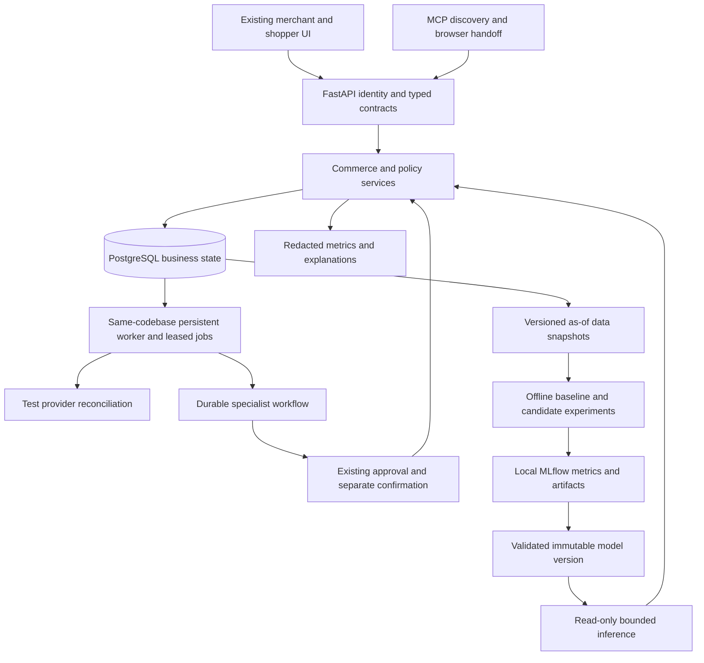

# CartPilot upgrade architecture

Status: proposed design, not implemented migrations or API contracts. Baseline and
risks: [audit](REPOSITORY_AUDIT.md). Delivery order: [roadmap](UPGRADE_ROADMAP.md).

## Preserve the modular application

Keep React/TypeScript and the FastAPI application with SQLAlchemy/Alembic/PostgreSQL.
Extract domain services from route imports as those paths change; do not rewrite
specialists or move business policy into UI/LLM prompts. Existing routes remain
compatible during staged rollout. Heavy native ML dependencies belong in a separate
optional local training environment, not the Vercel runtime dependency subset.

The API owns authorization and transactions. Workers only perform permitted claimed
jobs, never obtain approval from model output. PostgreSQL owns durable work; an optional
cache is disposable. No paid service or microservice migration is required by this plan.

## Commerce consistency and proposed additive schema

Names below are design candidates, to be finalized with migration/data preflight.
Existing `Order` represents imported/seeded historical sales. Prefer distinct
`CommerceOrder`/lines initially, with explicit origin and reconciliation into analytical
views, rather than converting every historical row into a checkout order.

| Record | Purpose and constraints |
| --- | --- |
| Cart extension / normalized lines | Retain current UUID/snapshot and audit; version, currency, environment, review hash and optional stable customer reference; quantity/price checks; no cross-tenant product references |
| InventoryAllocation / pool | Tenant, product, environment, cart, quantity, expiry, state and unique lease identity; separate sandbox balances from physical/source inventory; no double counting source reserved/unavailable stock |
| CommerceOrder / lines | Unique originating cart and checkout identity within environment; immutable purchased title/SKU/price/tax/quantity snapshots, currency, monetary totals, payment and fulfillment states |
| PaymentAttempt / webhook inbox | Provider/environment/event ID uniqueness, request fingerprint, reference, payload digest and bounded verified normalized fields; pending/succeeded/failed/unknown outcomes |
| Outbox / job | Unique business operation, status, attempts, due time, lease owner/expiry, bounded retry, terminal failure and manual review; transactionally inserted beside business changes |
| Inventory movement | Unique source event and allocation reference for consume/release/adjust; explicit reason and actor; append-only application history |
| Domain event / provenance | Tenant, event ID/time/recorded time, source/environment, schema version, eligible-for-training label and snapshot/version references; deduplication |

Phase 19 defaults off. First validate reservation behavior in an isolated sandbox stock
pool copied explicitly from local fixtures; do not let test payments decrement physical
stock, overwrite Shopify reserved counters or enter real revenue. The environment key
is server assigned, never trusted from arbitrary client input. Default legacy simulation
remains available. Shopify remains a read-only cache: it is not authoritative inventory
for a CartPilot-controlled live checkout. Any future live allocation needs a separate
source-of-truth/integration decision as well as explicit live-payment authorization.

Within one transaction, lock eligible inventory/pool rows in ascending product ID,
expire/release leases under the same lock, and check:

`allocatable = max(0, physical - source_reserved - unavailable - active_local_leases)`.

All readers of the enabled pool use the same availability contract. The existing
`Inventory.reserved_quantity` remains source/manual data; do not increment it and then
also subtract a new lease. Add a unique active allocation identity and guarded state
transitions; ensure lease sum cannot exceed pool capacity. Because cross-row sums cannot
be enforced by an ordinary CHECK, serialize on the pool row and use a guarded aggregate
counter or equivalent atomic conditional update. Record expiry, consume and release once.
No external provider call may run while holding inventory locks.

Approval records a cart version/review hash; checkout separately confirms, rechecks
identity/policy/current quote and validates or acquires the lease. Edits/repricing create
a fresh review version and invalidate approval. Paid-after-expiry/out-of-stock is an
explicit `payment_review_required` result, not automatic fulfillment or silent refund.
Reservation expiry and provider payment expiry are distinct clocks.

## Orders, payments and failure recovery

Proposed order states: awaiting_payment, confirmed, fulfillment_pending, shipped,
delivered, cancelled, return_requested, returned; payment state is separate (pending,
captured, partially_refunded, refunded, failed, unknown). Avoid one string encoding
every combination. Test shipments/receipts are clearly marked simulations.

1. Commit an idempotent payment intent and outbox request before network work.
2. Dispatch using the provider's supported idempotency/reference contract; never assume
   that a retry is safe because an HTTP response was lost.
3. Verify webhook signatures on bounded raw bytes, persist a unique inbox event, then
   apply the event under order/payment locks with amount/currency/reference checks.
4. A repeated event acknowledges the existing result. Out-of-order events cannot regress
   terminal facts; incompatible facts enter visible review. A webhook arriving before
   link persistence remains replayable through its validated reference.
5. Reconciliation leases due pending/unknown attempts and reads authoritative provider
   status; respects pagination/rate budgets/backoff and never blindly repeats a charge.
6. Lock/reload after network calls, compare expected versions and apply guarded transitions.
   Provider success plus DB failure is recoverable from inbox/reconciliation.
7. Order creation, test stock consumption and analytical event publication are unique
   transactional effects. Refund totals include pending reservations against the balance;
   unknown outcomes block further refunds. Returns do not automatically restock/refund.

This is at-least-once delivery with idempotent effects, not an unsupported promise of
exactly-once external execution. Expired worker leases can be reclaimed; completed
business effects cannot be repeated. Retry exhaustion produces an inspectable queue.

## Data and ML contracts

Add explicit source/environment to eligible sales and behavioral events before model
training. Preserve both occurrence and arrival times to avoid using late-arriving
information in historical features. Every dataset manifest includes tenant scope,
as-of cutoff, query/schema/git version, checksums, row counts, source filters, missingness,
train/validation/test boundaries and target definition. Synthetic fixtures demonstrate
plumbing only. Imported totals are not uncensored demand; stockouts, unknown observation
days, returns and irregular availability require flags or exclusion.

Forecast target: daily units per product/store, with separately evaluated 7/14/28-day
horizons. Compare last-value/seasonal-naive, moving-average and intermittent-demand
baselines. Use LightGBM first as a CPU tabular candidate with lagged/shifted rolling
demand, known calendar, and genuinely available price/stock features. Compare XGBoost
only with the same folds/data/budget; do not install both into request serving by default.
Hold the final time interval untouched; rolling validation folds must purge training
labels overlapping validation horizons. Future realized stock/price/promotions cannot
be prediction-time features. Quantile or residual calibration uses validation only.

Store immutable forecast/model metadata, uncertainty intervals, training-data range,
evaluation results, feature schema and artifact hash. Serve precomputed bounded forecasts
first, with stale/insufficient-data fallback. Models may recommend, not execute. A champion
alias references an approved immutable version; loading only trusted artifacts avoids
arbitrary pickle execution. Keep local model experiments on loopback.

MLflow provides separate metadata and artifact storage. Start locally with SQLite
metadata and a private artifact directory; shared PostgreSQL metadata/artifact hosting
requires access controls, retention and backups. This is proposed infrastructure,
not currently deployed. [MLflow backend documentation](https://mlflow.org/docs/latest/self-hosting/architecture/backend-store/),
[artifact documentation](https://mlflow.org/docs/latest/self-hosting/architecture/artifact-store/).

## Retrieval, personalization and multimodal search

First extract one retrieval/ranking service shared by shopper search, suggestions and
merchant preview, fixing audit A12. Apply merchant, status, currency, price/budget and
availability eligibility before ranking and recheck before purchase. Retain lexical,
category, co-purchase and Item2Vec baselines with component explanations.

Log impression/request IDs, eligible candidates, positions, policy/model versions and
consented interactions. A selection is an exposure-biased signal, not proof of relevance
or revenue uplift. Use time-separated query/session groups for learning-to-rank; do not
split products from one query across train/test. Delay labels until their outcome window
matures. Cold/new users use current session context; cross-device identity requires
consent and deletion/retention design. No cross-merchant histories by default.

Evaluate exact vector retrieval before ANN. pgvector offers exact search as well as
optional approximate indexes; tenant filtering and measured recall are required when
choosing index strategy. It remains deferred until catalog scale/latency warrants it.
[pgvector documentation](https://github.com/pgvector/pgvector).
Query-group objectives are supported by XGBoost's ranking API; the application still
owns eligibility and evaluation. [Official LTR guide](https://xgboost.readthedocs.io/en/release_3.0.0/tutorials/learning_to_rank.html).

Image phase adds bounded validated bytes, magic/type/dimension/pixel checks, metadata
stripping, decompression limits, scoped assets and safe storage/retention. Do not fetch
arbitrary user URLs. Evaluate a licensed image/text encoder locally on a labeled catalog
sample; pin encoder/preprocessor identity and dimensions. Store image content hashes and
embedding versions; stale/deleted assets stop appearing. Blend calibrated image/text
signals after eligibility gates; explain similarity as retrieval evidence, not verified
product attributes. No image model is selected or downloaded in this planning release.

## Durable orchestration and optimization

Extend AgentRun with a workflow/run identity, node status, immutable input snapshot,
version, checkpoint, lease and retry policy; separate immutable recommendation results
from approval/execution state. Resume after approval through existing Action/Approval
services with fresh revalidation. Any edit or changed state invalidates old authorization.

Evaluate a small SQL state machine against LangGraph in phase 23. LangGraph persistence
can checkpoint execution, but does not replace application authorization or external
side-effect idempotency. Adopt it only if a restart/review/branching prototype demonstrates
less complexity. [LangGraph persistence](https://docs.langchain.com/oss/python/langgraph/persistence).
This refers to product workflows, not spawning coding assistants.

Forecast-aware inventory scenarios use demand intervals, lead/safety times, holding and
stockout costs, budget, supplier MOQ and capacity. Price scenarios enforce known cost,
margin/step bounds and inventory risk. Observational forecasts do not identify price
elasticity: without valid causal evidence, keep price recommendations conservative and
label assumptions. OR-Tools is justified only for demonstrated coupled constraints;
otherwise bounded heuristics suffice. Solver results need feasibility rechecks, timeouts
and deterministic fallback. [Official optimization guide](https://developers.google.com/optimization/mip).

## Product, security and operations

Extend current pages with observed versus forecast tabs, demand intervals/as-of labels,
source/sample-size cards, reason components, workflow timeline and model freshness. Keep
one explicit review step followed by a separate confirmation for sensitive actions.
Keep business rules server-side. Add typed status unions, generated or checked API
contracts, reusable query/loading/error states and readable Commerce Studio panels.

Start request IDs, structured redacted events, scoped metrics and worker heartbeats in
phase 19. Later add provider latency/errors, reconciliation age, inventory conflicts,
queue lag, model inference/fallback rate, data freshness, drift and delayed-label quality.
Avoid merchant/query/token labels in public metrics. No raw prompts/secrets/payment
payloads in traces. Define dependency advisory review, body/egress controls, role/identity
hardening, retention and backup restore as release gates. Existing CORS is not an auth
boundary, and a hash-linked ledger is not tamper-proof against a privileged DB writer.

Deploy backwards-compatible API/schema first, worker second, frontend last where needed;
keep migrations outside requests. Roll back features/model aliases rather than dropping
tables with business history. Train offline on macOS CPU; serverless stays lightweight.
Proposed initial latency budgets are in the test strategy and require measurement.
